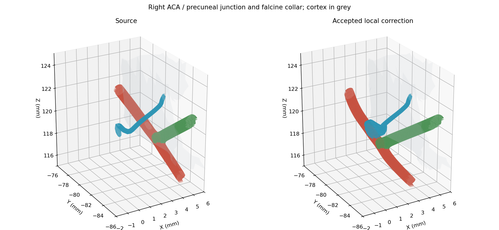

# ACA registration batch 4, v0.9.96

The right ACA A5/falcine native attachment is repaired with 32 exact shared coordinates and opposite paired boundary edges. This is a bounded local correction within the wider ACA/pericallosal batch; bilateral G05 and whole G06 acceptance remain open.

The source opening lay inside the closed right posterior cingulate surface. A connected medial adjustment moves the local A5 and precuneal root by at most 2.1 mm. A 5 mm geodesic taper along the precuneal branch avoids the deeper tissue embedding caused by a broad spatial branch shift. All 148 shared A5/precuneal coordinates are mapped identically, and all other native joins remain fixed. The 32 new falcine interface normals also match exactly across labels.

The malformed A5 lip is set back by 0.25 mm geodesic distance, removing 168 local triangles and two of three pre-existing local self-intersection pairs. A collar joins the source falcine branch clipped at Z=121 mm to the rebuilt parent opening. No synthetic cap or Boolean result is installed. The remaining source self-intersection pair is retained explicitly; full parent/receiving-lumen acceptance is not claimed.

All new collar faces pass whole-scene crossing and tissue-clearance gates. The combined three-label native boundary count reduces from 567 to 412 with no non-manifold or misoriented edges. Across all changed faces, 111,740 triangle pairs are checked. There are no new strict crossings; existing cortical embeddings are assessed separately with corresponding source/candidate samples. The local retained A5/posterior-cingulate changed-face samples clear their former embedding, with maximum sampled depth decreasing from 0.7733 mm to zero. Existing A5/middle-posterior cingulate and more distant precuneal embedding remain. Paired samples show no new tissue entry or increased depth beyond the 0.001 mm numerical tolerance. Open targets pass conservative surface-separation bounds; inside/outside is not inferred from open meshes.

All 1,250 named meshes, 1,666 catalogue structures, relationships and 21 runtime source files are retained. The other 596 arterial meshes and four other assets remain exact. Retained source face corner normals are preserved. Three DSA proxies/courses are refreshed and 594 other courses, graph and vein sites retained. Detailed evidence is in `anatomy/source/aca-registration-v0.9.96`; authoring replay is documented in `tools/aca-registration-v0.9.96/README.md`.

The separate 12-segment cohort still has one unresolved ILT posteromedial native interface. The broader bilateral pericallosal/callosal registration, residual cortical embedding, one local source self-intersection pair, Galenic/dural alignment, independent canal targets and full anatomical receiving lumens remain open. The right native root repair does not resolve those findings.

Production build, DSA checks and all 19 repair tests pass. Independent reconstruction reproduces every accepted physical triangle exactly.
