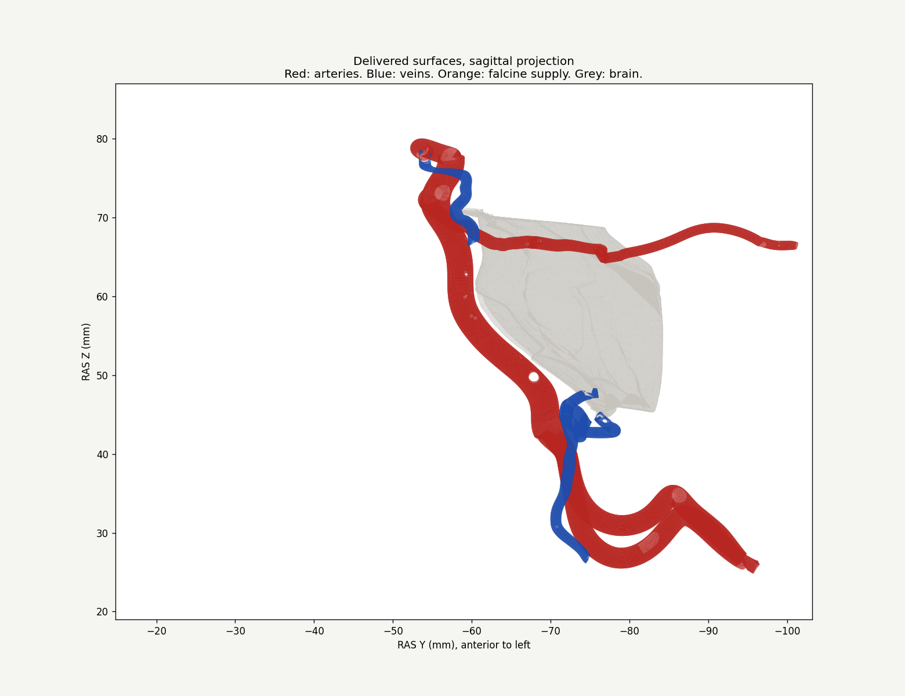
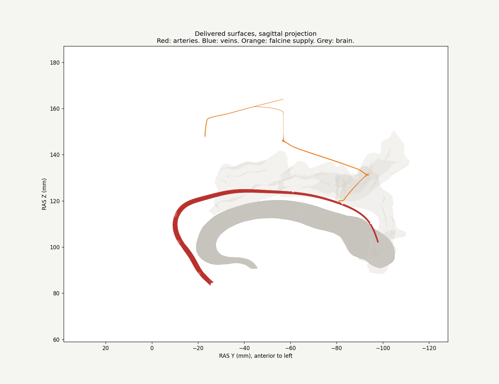

# Anatomy batch 1, v0.9.83

Review date: 14 October 2026. Geometry: unchanged v0.9.67 checkpoint, decoded from the five delivered GLBs. This release reconciles the issue records and information text. It does not certify the atlas or refit the vessels.

## Posterior crossings, G02

All 12 original artery–vein pairs have **zero triangle intersections** in the current delivered surfaces. The [machine-readable report](validation/batch1-v0.9.83.json) lists each pair, asset hashes and sampled vertex-to-triangle distances. The smallest sampled wall distance is about 0.015 mm, between the right posterior communicating artery and posterior communicating vein. These small numerical clearances are not physiological measurements or a clearance safety margin.

At the two tested axial levels, Z = 70 and 75 mm, the anterior pontomesencephalic vein lies posterior to the basilar artery by approximately 2.63 and 2.47 mm between section mean Y coordinates. This agrees with the anatomical relationship described by Gabrielsen and Amundsen [1]. It does not establish every venous course or crossing order. The historical G02 correction remains implemented, with a passing current intersection check and limited depth review. Wider anatomical acceptance remains incomplete.



Red: arteries. Blue: veins. Grey: registered pons. Anterior is to the left. This is a projection of the delivered triangles, not a new model or angiogram. Apparent overlaps in projection are not necessarily intersections in 3D.

## Pericallosal registration, G05

The old warning cannot be closed from the later generic “callosal repair checked” statement. Current meshes still show these contacts:

- Bilateral A2: gyrus rectus surfaces.
- Bilateral A3: superior frontal gyrus surfaces. Their sampled minimum wall-to-callosum distances are 9.36 mm left and 8.90 mm right.
- Bilateral A4: anterior and posterior middle cingulate surfaces.
- Bilateral A5: posterior cingulate surfaces; left A5 also intersects the corpus-callosum surface.

All six adjacent ACA segment pairs retain matching seam coordinates, with 63 or 64 shared positions per pair. This supports retention of the current segment seams, not full lumen or anatomical acceptance. Counts are contacted triangle pairs from the specified VTK mode, not separate defects. Registered atlas surfaces and vascular reconstruction must be reviewed together; contacts alone do not identify which surface should move.

G05 remains **correction-required**, now consistently covering A2–A5 on both sides. The previous rejected displacement trial is historical evidence, not a repair to rerun. The later geometry batches need a coordinated pial/callosal fit that preserves parent and branch interfaces.



Red: right A2–A5. Grey: corpus callosum and translucent cingulate surfaces. Orange: selected falcine supply. This sagittal projection illustrates the course; the measured 3D contacts and attachment gaps are recorded separately.

## Falcine parents and interfaces, G06

- **Anterior falcine, both sides:** retain anterior ethmoidal parent. Original cadaveric injection and angiographic evidence supports this origin [2]. Each delivered native parent rim has 90 matching coordinates. This is an origin/interface check, not approval of the entire course. The left MMA information link retains its existing legacy ID, which resolves to the left-sided artery.
- **ACA falcine, both sides:** a pericallosal dural branch to the falx is supported by the original dissection in figure 3 of Bhogal et al. [3]. The exact A5 label remains an estimated origin in this reconstruction. Neither branch has matching coordinates with A2, A3, A4 or A5. The closest sampled wall distances to the assigned A5 are 3.574 mm left and 2.294 mm right. No alternative segment supplies a demonstrated join. Retain the parent provisionally and repair the physical attachment as part of the connected route.
- **MMA falcine terminal, both sides:** retain the paramedian MMA parent provisionally. Neither terminal shares native coordinates with that parent; their sampled minimum distances are 0.135 mm left and 0.008 mm right. Proximity does not demonstrate a patent lumen or independently certify the exact named parent.
- **ACA falcine–MMA falcine connections:** both endpoint rims have matching coordinates. Upstream ACA and MMA attachment findings still prevent acceptance of the whole network.
- **Anterior falcine–MMA paramedian connections:** the delivered communication components have no boundary edges. A coordinate touch or close approach to another surface cannot establish an open lumen. Keep these labelled as potential anastomoses and retain physical continuity review.

The catalogue parent IDs and flow graph are unchanged. Information text distinguishes the ethmoidal anterior falcine artery from a pericallosal dural branch. Source support for an anatomical origin is recorded separately from verification of this model's attachment.

## Remaining scope

The 12 previously deferred segments in the left tentorial–mastoid, right tentorial and left posterior cavernous networks are unchanged. G01 dural/deep venous alignment, G03 canals, G04 ICA segment boundaries, the four unreviewed middle meningeal vein course specifications and whole-atlas lumen continuity remain outside this batch. The root [issue register](../ANATOMICAL_ISSUES.md) now distinguishes the passing posterior intersection check from the unresolved pericallosal and falcine findings. The 12 deferred segments are not a total count of all atlas defects.

## Reproduce the measurements

The app does not require scientific Python packages. For this optional offline review, install NumPy, SciPy and VTK in a separate environment, then run from the release root:

```bash
node tools/decode-posterior-baseline.mjs public/anatomy/models /tmp/atlas-batch1/decoded
python tools/audit-batch1.py /tmp/atlas-batch1
```

The decoder records asset hashes; the audit writes `/tmp/atlas-batch1/measurements.json`. Mesh positions are RAS millimetres and the current GLB nodes have no transforms. Collision mode is VTK half contacts, cell tolerance 1e-7 mm, box tolerance zero, two cells per node. Distances query every vertex of the first surface against triangles of the second, giving a sampled upper bound on the continuous minimum. Shared positions use a 1e-5 mm tolerance; they do not alone prove shared topology or an open lumen. Tissue checks cover delivered brain and venous surfaces only. This is not a new whole-atlas clearance audit.

## References

1. Gabrielsen TO, Amundsen P. *The Pontomesencephalic Veins: A Roentgenographic Study*. Radiology. 1969;92:889–896. [Publisher anatomy section and methods](https://pubs.rsna.org/doi/10.1148/92.4.889). Only accessible sections consulted.
2. Pollock JA, Newton TH. *The Anterior Falx Artery: Normal and Pathologic Anatomy*. Radiology. 1968;91:1089–1095. [Publisher anatomy section](https://pubs.rsna.org/doi/10.1148/91.6.1089). Only accessible sections consulted.
3. Bhogal P et al. *Normal pio-dural arterial connections*. Interventional Neuroradiology. 2015;21:750–758. [Original cadaveric and angiographic illustrations, figures 2–3](https://pmc.ncbi.nlm.nih.gov/articles/PMC4757356/). Used for general pericallosal origin support, not an exact A5 origin.
