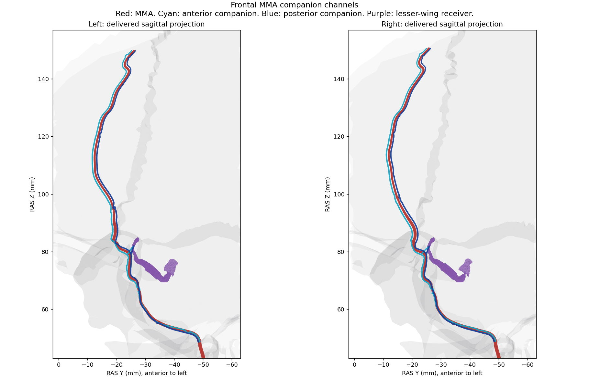

# Anatomy batch 2: middle meningeal vein courses

14 October 2026. Four course specifications are now complete. Model buffers remain at the v0.9.67 checkpoint. This batch adds authored review guides, anatomical descriptions, drainage/companion relationships and a small correction to DSA drainage selection. Detailed containment and full lumen continuity remain open.

## What the four labels represent

The left and right meshes named `middle_meningeal.anterior` and `middle_meningeal.posterior` form a companion pair along the MMA trunk/frontal corridor. The positional labels do not identify frontal and parietal arterial divisions. Original dissection and corrosion-cast work supports paired channels beside the frontal MMA and their connection with the lesser-wing sinus [1]. A separate cadaveric study supports paired dural channels and a plexiform arrangement near foramen spinosum [2]. These studies support a regional pattern, not these exact coordinates or calibres.

The existing display names and anatomical IDs are retained. New alternate names and descriptions explain the positional meaning. Each channel is now grouped under its represented lesser-wing (sphenoparietal) receiver, with a `drains_to` relationship and links to the accompanied MMA trunk and frontal branch. The legacy sphenoparietal name is retained. A later histological study also documents meningeal tributaries and anatomical variation [3]; the atlas does not treat all descriptions of this region as interchangeable.

## Course contracts

Each specification includes:

- The exact delivered venous asset hash and brain registration.
- A shaft guide with 100 stations measured from axial sections of the current surface, ordered cranial to caudal. This order is a review convention, not a blood-flow direction.
- Two contiguous, source-bound ranges: cranial dural course and basal bony corridor. Point hashes, arc lengths and coverage are validated at build time.
- Named frontal/parietal and sphenoid/temporal bone references, arterial companions, receiving sinus and the regional spinosum landmark.
- Radius-preservation and native-interface constraints.
- A reference to the measured shared receiving seam. The short spur is described by its common exterior interface, rather than inventing a recovered authoring centreline.
- Explicit missing targets for a segmented dural layer and foraminal lumen. The coarse landmark is not substituted for either target.

The four entries are removed from `deferredCourseSpecifications`. Zero course-specification exemptions remain. This closes the missing-authoring task while preserving the unresolved anatomical findings as G07. The build validator now permits bone targets only for explicitly dural or bony-groove segments; pial and other neural course constraints remain enforced.

## Current delivered geometry review

All four channel meshes are single connected components, with zero detected non-adjacent self-intersections, degenerate triangles, duplicate triangles or non-manifold edges. None intersects the tested arterial or brain surfaces. These are geometric checks, not full anatomical acceptance.

Each channel shares actual exterior boundary edges with its lesser-wing receiver: 13 and 11 on the left, 11 and 11 on the right. These are seam arcs within a common partition, not four independently closed circular ostia. The paired channels and receiver reassemble into one component on each side, with no detected folds, duplicate triangles or non-manifold edges.

Both combined receiver components retain open boundaries: 108 edges left, 112 right. Only 57 and 55 edges respectively match the cavernous surface in this limited interface check. Full receiver closure is therefore not claimed. The cranial and caudal shaft endings are capped. Neither an SSS connection nor a pterygoid connection is inferred from an end cap.

Current bone intersections involve the frontal and sphenoid surfaces, plus the left parietal surface. Contact counts alone cannot distinguish a valid diploic/groove relation from erroneous penetration in these coarse surfaces. The left anterior companion also intersects the foramen-ovale emissary surface; this is recorded as a contact requiring local review, not promoted to a communication.



These are exact delivered triangle projections, with lateral bone context cropped to the relevant region. Projection overlap alone is not a 3D collision. The [numerical report](validation/meningeal-v0.9.84.json) records every channel, contact, topology result, guide-distance distribution and input asset hash.

## DSA correction

Both frontal companion channels now use the declared lesser-wing receiving route. The unsupported direct posterior-companion to pterygoid shortcut is removed. Selective frontal MMA injections retain both eligible members of the pair even when the approximate blush field favours one representative vein site. Selective posterior-convexity or petrosquamosal injections no longer reuse a frontal companion as though its label represented a posterior arterial territory. Dedicated posterior-division venous coverage remains absent. Other DSA rendering, injection, camera and inspection behaviour is unchanged.

## Work carried forward

G07 retains exact dural and canal containment, missing cranial/caudal drainage continuations, full receiver boundary closure and the left emissary contact. These belong in local venous fitting and later continuity work. G01, G03, G04, G05, G06 and the 12 previously deferred regional segments remain open. No vessel, brain or skull surface was moved to manufacture a passing result.

## Reproduce

The app has no new runtime dependencies. Offline review uses NumPy, SciPy and VTK 9.3, with the existing VTK triangle helper:

```bash
node tools/decode-posterior-baseline.mjs public/anatomy/models /tmp/atlas-meningeal/decoded
python tools/audit-meningeal-courses.py /tmp/atlas-meningeal
```

The audit writes `meningeal-review.json` and `meningeal-review-guides.json` in the work directory. Geometry is RAS millimetres, with no node transforms in these delivered assets. Distances are sampled vertex/guide-to-triangle queries, not exact continuous clearance or physiological measurements. Shared seams use exact delivered float32 coordinates. Collision counts use VTK half contacts with tolerance 1e-7. The audit checks boundary incidence and non-adjacent intersections separately from clinical course support. Full network containment is outside this review.

## References

1. San Millán Ruïz D, Fasel JHD, Rüfenacht DA, Gailloud P. *The Sphenoparietal Sinus of Breschet: Does It Exist? An Anatomic Study.* AJNR. 2004;25:112–120. [Original anatomical findings and figure 3](https://pmc.ncbi.nlm.nih.gov/articles/PMC7974157/).
2. Fishpool SJC, Suren N, Roncaroli F, Ellis H. *Middle meningeal artery hemorrhage: an incorrect name.* Clinical Anatomy. 2007;20:371–375. [Original cadaveric study abstract](https://pubmed.ncbi.nlm.nih.gov/16944530/), DOI 10.1002/ca.20377. Abstract consulted.
3. *The Sphenoparietal Sinus Revisited: Anatomical and Histological Study With Application to Interventional Procedures and Skull Base Surgery.* 2023. [Original cadaveric/histological study](https://pmc.ncbi.nlm.nih.gov/articles/PMC9899132/), PMID 36751209.
