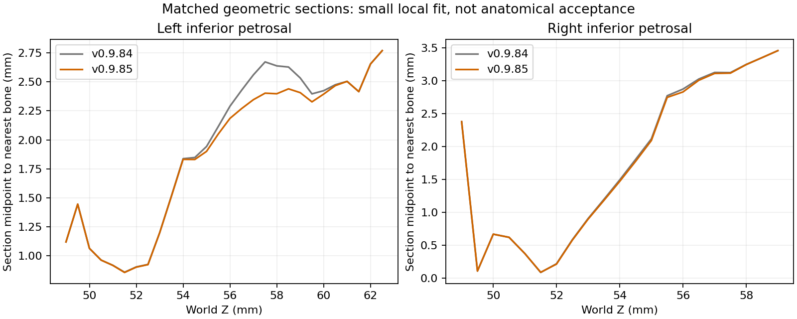

# Batch 3: local venous review, v0.9.85

Twenty labels were reviewed: bilateral superior and inferior petrosal sinuses, vertebral veins and periarterial plexuses, inferior alveolar, infraorbital, central retinal and internal auditory veins, and the four middle meningeal companion channels. Three surfaces received bounded local corrections. All other 1,247 meshes and every triangle index remain unchanged.

## Corrections delivered

- Left anterior middle meningeal companion: maximum displacement 0.080 mm clears the previous foramen-ovale emissary overlap, from 20 triangle contacts to zero. Native seams and each translated axial contour are preserved. No new contact objects, self-intersections or reversed faces.
- Left inferior petrosal shaft: maximum displacement 0.360 mm. Median nearest-bone distance at moved vertices decreases from 2.033 to 1.934 mm; all 929 moved vertices become closer. Existing bone contacts do not increase. Native boundaries and shared coordinates remain exact.
- Right inferior petrosal shaft: maximum displacement 0.162 mm. Median nearest-bone distance at moved vertices decreases from 2.084 to 2.055 mm; 433 of 455 moved vertices become closer, 19 slightly farther. The mean change is −0.031 mm. The sampled minimum wall gap is unchanged because the fixed wall remains nearest; this is a small fit improvement, not full apposition.

These are geometric distances to supplied bone surfaces, not physiological measurements. The petrosal deformation diagnostic uses matched world-Z section radii. The 95th-percentile absolute fractional change is 4.61% left and 3.89% right. Larger trials exceeded the 5% gate and were rejected. No new contact objects, self-intersection pairs or reversed faces were introduced. Existing basilar receiving-volume contact counts increase slightly; this is not certification of a patent join.

## Review outcomes and remaining work

Superior petrosal shafts already approach the represented petrous bone laterally. Forcing the medial transition onto the nearest bone would not establish the correct variable drainage pattern. Existing open walls, multiple components, degenerate faces and arterial contacts require a coordinated regional repair. These two meshes are retained, with their findings explicit.

Inferior petrosal walls remain open and retain three non-adjacent self-intersections on the left and one on the right. Existing bone contacts remain. The local improvements do not resolve the regional lumen or prove containment in a segmented petro-occipital groove.

The ten companion additions are individually closed, single-component meshes without non-adjacent self-intersections or contacts with represented brain/arterial surfaces. Retain their selected regional configuration. Cervical vertebrae, exact transverse foramina, relevant nerves, precise canals and globe targets are absent or insufficiently segmented, so further detailed fitting would be unsupported. Separate overlapping receiving volumes do not prove a merged continuous lumen. Parent vertebral veins also retain open walls.

G07 now records the left meningeal/emissary overlap as cleared. Exact dural and bony-groove containment, spinosum passage, capped endpoints and full lesser-wing receiver closure remain open. All 12 deferred arterial segments and earlier G01/G03/G04/G05/G06 findings are retained. Whole-atlas anatomical acceptance remains incomplete.

## Data and implementation

Only three position/normal streams in venous.glb change. Coordinates use lossless meshopt Float32 with no additional positional quantisation; normals retain the established 12-bit encoding. All native boundary and shared coordinates remain exact, and native seam normals are retained. Other four GLBs are byte-identical. IDs, hierarchy, relationships, triangle order and application runtime source are unchanged.

DSA projection topology and cap recipes remain valid because native boundaries and indices are unchanged. The authoring refresh independently compares old/new meshes, verifies fixed boundaries and closed oriented projection edges, recomputes three proxy volumes and venous sites, and updates geometry hashes. Arterial courses, flow graph and section data are reused unchanged. The full DSA validators run on the exported GLBs. DSA proxies are rendering volumes; their closure does not certify native anatomical lumen closure.

See [measurements and rejected trials](validation/local-veins-v0.9.85.json) and [release checks](validation/batch3-release-v0.9.85.json). The review scripts are authoring tools, not browser dependencies.

## Anatomical support

- Shimada et al., AJNR 2013: original angiographic series documenting segmental superior-petrosal drainage and variable cavernous communication. [Original article](https://pmc.ncbi.nlm.nih.gov/articles/PMC7964905/).
- Morphology of the groove of the inferior petrosal sinus, Anatomy & Cell Biology 2022: original skull study supporting the regional petro-occipital course and its variation. [Original article](https://pmc.ncbi.nlm.nih.gov/articles/PMC9256480/).
- Magro et al., J Neurosurg 2015;123:118–125: original dissection, histology and MR study of transverse-foraminal venous organisation. [Original study](https://pubmed.ncbi.nlm.nih.gov/25526272/).

These sources support regional anatomical interpretation, not the atlas coordinates or anatomical acceptance of these repairs.
