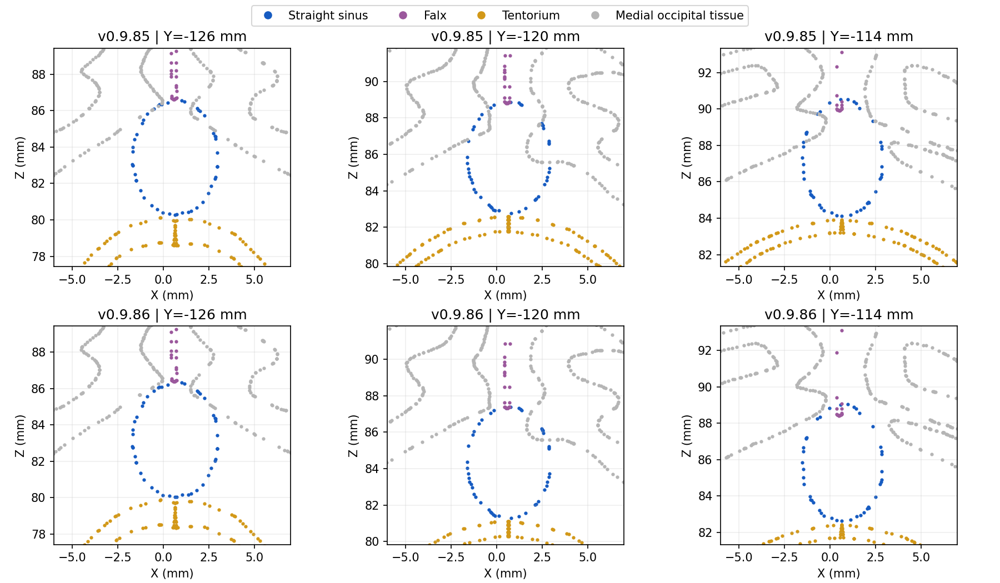

# Batch 4: falcotentorial and Galenic review, v0.9.86

This release delivers a limited straight-sinus shaft and adjoining dural correction. **G01 remains open.** No anatomical finding is claimed fully closed by this batch. The larger Galenic refit did not pass regression checks and is excluded.

## Delivered correction

A maximum 1.5 mm inferior displacement affects the central/anterior straight-sinus shaft, tapering to zero at all native venous interfaces. The medial tentorial surfaces and inferior falcine edge move with it. The falx body beyond a short edge transition stays fixed. The skull, parenchymal brain surfaces, all arteries, Galen and its tributaries retain their previous geometry.

The field is constant across each coronal sinus section before triangle interpolation. The measured 95th-percentile absolute fractional change in matched coronal median radius is **0.38%**. This is a geometric deformation diagnostic, not physiological calibre accuracy. No simplification, extra coordinate quantisation, topology changes or new anatomy are introduced.

Native sinus boundary coordinates and all pre-existing shared coordinates with Galen, confluence, superior sagittal sinus and right transverse sinus remain exact. All triangle indices remain exact. Only four of 1,250 position streams change: straight sinus, falx and the two tentorial surfaces. Recomputed normals are confined to affected faces; native sinus seam normals and unaffected normals remain exact after encoding.

## Measured improvement and limits

| Straight sinus contact | v0.9.85 triangle contacts | v0.9.86 triangle contacts |
|---|---:|---:|
| Left precuneus | 60 | 40 |
| Right precuneus | 96 | 85 |
| Left lingual gyrus | 392 | 137 |
| Right lingual gyrus | 340 | 257 |

These four tissue-contact pairs remain unresolved. Facet counts measure surface intersections, not numbers of separate anatomical defects. The accepted candidate introduces no new contact objects, non-adjacent self-intersections or reversed faces, and does not increase parenchymal or bone contact counts. Existing sinus/arterial contacts do not increase. Contacts between already overlapping dural arterial branches and their dural context can change slightly; every count is retained in the measurements. This does not certify arterial embedding or native lumen closure.

The direct native interfaces include 32 shared Galen/straight boundary edges, 27 inferior-sagittal/Galen edges and 24 straight/confluence edges. The ISS opening meets faces allocated to the Galen label in this mesh partition. Catalogue drainage is retained; a label-boundary review and whole-complex closure check are still required. The torcular label has two components and open boundaries. Individual DSA rendering proxies are closed volumes and do not prove closure of these native anatomical surfaces.

## Root causes and rejected approaches

The old centreline-to-tentorium distance alone is insufficient: in many sections the source sinus roof follows the inferior falcine edge while its floor approaches the medial tentorium. Raising the dura to the centreline would therefore distort the surrounding anatomy. Actual surface intersections with parenchyma are a separate, confirmed defect.

Galen intersects the registered splenium and medial cortical surfaces. Pure inferior and posteroinferior shifts were tested on the connected inlet region. Broader connected fitting introduces new medial posterior choroidal arterial contacts at internal cerebral tributaries, plus other deep-vein/tissue conflicts. Those candidates are rejected. A 2 mm shaft field also failed face-orientation checks. Applying even a smaller field to too much of the falx body introduced a cuneal regression and a reversed face. Restricting the final falcine displacement to its inferior edge removes those regressions.

The retained correction improves the local fit while keeping the known native venous interfaces fixed. It does not complete Galenic/splenial registration, resolve the four residual sinus/cortical intersections, repair posterior sinus/arterial contacts or establish a closed native lumen. These remain explicit G01 work, alongside the earlier deferred issues.

## Export and app integration

Coordinates use lossless meshopt Float32 for the four changed streams, with the established 12-bit normal encoding. No additional positional quantisation is applied. Other three GLBs and all application runtime source remain unchanged. The three v0.9.85 local venous corrections are retained.

Brain registration records, bounds, course geometry hashes and surface anchors are refreshed. Anchors retain their original triangles and barycentric coordinates. The DSA authoring refresh checks the fixed sinus boundaries and projection closure, recomputes its proxy volume/site, and updates geometry hashes. Arterial flow courses, graph, section data and projection topology remain unchanged.

See [exact geometry, contact and rejected-trial measurements](validation/falcotentorial-v0.9.86.json) and [release checks](validation/batch4-release-v0.9.86.json).

## Anatomical support

- Suzuki et al., Neurol Med Chir 2005;45:387–394: original CTA study of 150 patients documents variation in Galenic angles and tributary configurations. It supports individual regional review, not a universal fitted angle. [Original article](https://www.jstage.jst.go.jp/article/nmc/45/8/45_8_387/_article/-char/en).
- Ye et al., Front Neuroanat 2020;14:573217: cadaveric/histological and imaging study documents complexity at the Galen/straight-sinus junction. Microscopic intraluminal features are outside this upgrade. [Original article](https://www.frontiersin.org/journals/neuroanatomy/articles/10.3389/fnana.2020.573217/full).
- Yamamoto and Kageyama, J Neurosurg 1980;53:205–221: cadaveric pineal-region study includes the Galenic system, surrounding arteries and tentorial notch. The abstract was consulted; it does not provide coordinate validation. [Abstract](https://pubmed.ncbi.nlm.nih.gov/7431059/).

The supplied anatomical notes remain the catalogue authority. These publications do not independently approve the atlas geometry.
