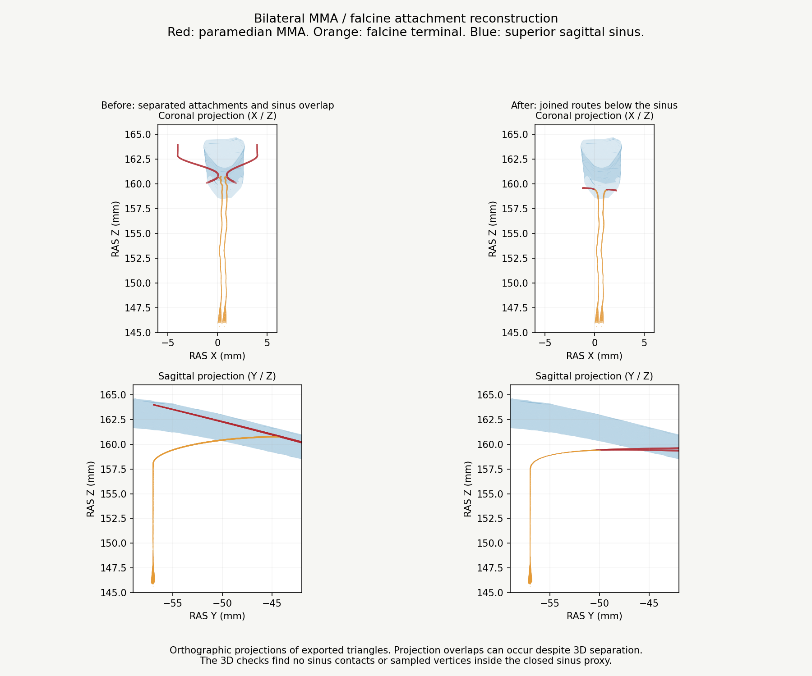

# Batch 5 continuation: MMA falcine connections, v0.9.88

This release continues the attachment work from v0.9.87. It repairs both local MMA paramedian-to-falcine terminal connections and clears the four edited surfaces from the represented superior sagittal sinus. G05 and G06 remain open. Whole anatomical acceptance is false.

## Delivered geometry

The distal paramedian route and proximal falcine terminal collar are reconstructed together on each side. Smooth Hermite centres and rotating cross-sections make a common exterior wall, divided at a new shared ring. Each interface has 50 exactly matching coordinates, 50 paired oppositely oriented boundary edges and identical encoded normals in the actual application loader. Both combined networks have zero non-adjacent triangle intersections in the local check.

Clipped parent remnants disconnected from the incoming route are excluded. Each revised paramedian mesh has one connected component. Each terminal retains the baseline number of components, including its existing small distal partition. This work establishes two local interfaces, not whole-network watertightness.

| Surface | Final vertices | Final native triangles | Protected original coordinates |
| --- | ---: | ---: | --- |
| MMA paramedian left | 3,763 | 7,374 | All 102 incoming rim vertices |
| MMA falcine terminal left | 3,238 | 6,334 | All 2,738 retained distal vertices |
| MMA paramedian right | 3,660 | 7,168 | All 102 incoming rim vertices |
| MMA falcine terminal right | 3,337 | 6,532 | All 2,839 retained distal vertices |

The four meshes previously produced 329 triangle contacts with the represented superior sagittal sinus; the final contact count is zero. An inclusion check against its closed DSA proxy changes from 2,219 sampled native vertices inside the proxy to zero. These counts are geometric diagnostics, not physiological measurements or counts of anatomical defects. The sinus itself is unchanged.

No new or increased contact with brain, bone or an unrelated vessel is accepted. Existing incoming frontal MMA and anterior falcine contacts remain unchanged. All other 595 arterial meshes retain exact decoded position, index and normal buffers, and the other four GLB assets remain byte exact. All 1,250 named meshes remain present in the 1,666-entry catalogue. The left ACA attachment repair from v0.9.87 remains intact.

## DSA and integration

The four edited closed projection recipes and arterial injection courses are refreshed. The first automatic centreline fit made the two falcine terminal courses unselectable, so their proximal injection routes use explicit authoring guides joined to the retained distal shaft. Each guide is bound to the SHA-256 of that mesh's raw Float32 position and Uint32 index buffers. Geometry mismatch stops course generation. The generator identity includes guide points, helper and builder source. These guides support injection geometry, not anatomical certification.

All four repaired courses remain selectable. The other 593 arterial entries, declared flow graph and vein sites are retained after checking unchanged geometry and dependency scope. Metadata, bounds, hashes, dural course classifications and issue status are updated. The application's 21 runtime source files are byte exact against v0.9.87. No app runtime code changes are introduced.

Validation passes: production build, 828 closed and oriented DSA proxies comprising 8,960,874 triangles, 578 selectable arterial courses, 2,350 closed sections, directed injection and meningeal drainage checks, and 14 course unit tests. The existing bundle-size warning remains. Geometry validation uses the actual GLTFLoader, retained-buffer comparisons, native interface and scene-contact checks, and one targeted region comparison. Full browser playback is not repeated for this batch.

## Remaining work and rejected candidates

- Right ACA falcine native attachment and bilateral pericallosal/callosal registration remain open. Trial collars and coordinated A5/precuneal shifts are excluded because they fold geometry or create or increase cingulate conflicts. Baseline surfaces are retained.
- Both upstream frontal-MMA to paramedian native interfaces remain open. The retained incoming rims have 102 coordinates each and zero exact matches to their respective frontal-MMA surfaces. Existing surface overlap does not prove a continuous native lumen.
- Whole falcine receiving-lumen continuity, precise dural containment, wider MMA route fit, all earlier G01/G03/G04/G07/G08 findings and the 12 deferred arterial segments remain open. Unchanged anatomy is not re-certified by this release.

## Evidence and reproducibility

See [geometry measurements and excluded trials](validation/mma-falcine-v0.9.88.json) and [release checks](validation/batch5-continuation-release-v0.9.88.json). Optional scientific authoring scripts are in `tools/native-attachments-v0.9.88`. Baseline snapshots of the four edited surfaces, final candidate buffers and provenance are in `anatomy/source/native-attachments-v0.9.88`. Scene-contact reproduction requires the full v0.9.87 model baseline. The ordinary app has no new dependencies.

The consulted abstract of [Martins et al., Microsurgical anatomy of the dural arteries, 2005](https://pubmed.ncbi.nlm.nih.gov/15794820/) supports overlapping arterial supply to the dura and falx. It does not establish the coordinates or dimensions of these atlas routes. [Bhogal et al., 2015](https://pmc.ncbi.nlm.nih.gov/articles/PMC4757356/) supports a pericallosal falcine branch; the atlas's exact A5 assignment remains illustrative. No patient-specific dimensional accuracy is claimed.
