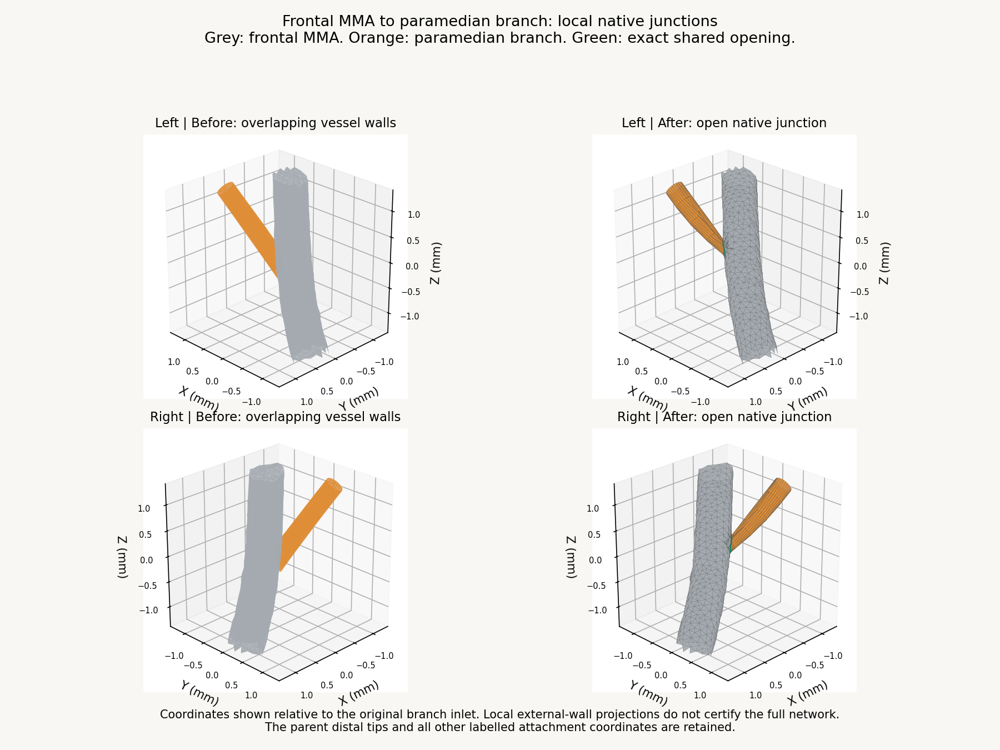

# Batch 5 upstream continuation, v0.9.89

Both frontal-MMA to paramedian native junctions are repaired. The previously overlapping surfaces now have actual openings, with no wall retained across the local branch entrance. This continues the v0.9.87 left ACA attachment and v0.9.88 bilateral MMA falcine work. Whole anatomical acceptance remains false; G05 and G06 are still open.

## Local repairs and limits

The source paramedian inlets overlapped intact frontal-MMA walls rather than matching an existing open parent rim. Ordinary VTK splitting and union trials left small holes or intersection defects, so they were excluded. The accepted construction uses a short inlet embedding, a robust exterior Boolean union and a constraint to the original combined parent/branch envelope. It preserves the represented parent distal tips and remote native interfaces.

The initial inlet adjustment fades over 1.5 mm, with maximum input displacements of 0.3084 mm left and 0.2765 mm right. The initial radial scale is 0.7. The displaced branch is intersected with the original combined vessel solid before the final union, preventing an outward enlargement of the represented route. New faces are assigned back to their original vessel labels. A 0.00000191 mm near-duplicate created by Float32 export on the right is welded to the retained original coordinate; two degenerate triangles are removed. The final tests, rather than the pre-weld trial, determine acceptance.

| Junction | Exact unique shared coordinates | Paired, oppositely oriented boundary edges | Combined self-intersections |
| --- | ---: | ---: | ---: |
| Left frontal MMA / paramedian | 78 | 78 | 0 |
| Right frontal MMA / paramedian | 79 | 79 | 0 |

The final combined walls have no non-manifold edge. Their remaining boundary edges are exactly the retained parent proximal rims and paramedian distal rims, not holes at the new junction. The right export has a duplicate vertex index at one shared coordinate; the unique geometric ring remains 79 coordinates and 79 paired edges.

All other labelled attachment coordinates remain exact. The 55/58 frontal-MMA proximal rims, 55-coordinate anterior-division seams and both 50-coordinate paramedian/falcine joins are retained. The actual application loader also confirms their retained normal values and identical normals across both new openings. The parent tips and all faces outside the bounded local repair region are unchanged. The farthest altered face vertex is 1.735 mm from its original inlet centre.

No new contacted structure is introduced. Some skull-contact facet counts change when an existing surface is split or relabelled, so those counts are not treated as new anatomical penetration. The final changed-face sample check finds no outward extension beyond the original combined vessel envelope above a 0.00002 mm tolerance. Maximum export rounding is 0.00000520 mm. Existing bone contact and exact dural fit remain unresolved. This is a local continuity repair, not an anatomical clearance certificate.

## Integration and validation

The four edited surfaces are MMA frontal left, MMA frontal, MMA paramedian left and MMA paramedian right. All other 595 arterial meshes keep exact decoded position, index and normal buffers. The other four GLB assets remain byte exact. All 1,250 named meshes remain in the 1,666-entry catalogue. The earlier ACA and MMA falcine repairs are preserved. The application's 21 runtime source files are byte exact against v0.9.88.

Bounds, asset hashes and local attachment metadata are updated. Four closed DSA recipes and their injection courses are refreshed. All four edited vessels remain selectable; the other 593 arterial course entries and existing falcine authoring guides remain unchanged. The anatomical graph and vein sites are unchanged. Directed attachment distances are recalculated only on the four edited source vessels.

Validation passes: production build, 828 closed and oriented DSA meshes containing 8,961,216 triangles, 578 selectable arterial courses, 2,350 closed sections, directed injection and meningeal drainage checks, and 14 course tests. The existing bundle-size warning remains. One targeted local visual review is used alongside the actual application loader and numerical checks. Full browser playback is not repeated.

## Remaining work

- Right ACA falcine native attachment.
- Bilateral pericallosal/callosal registration and existing cortical contacts (G05).
- Precise MMA bone and dural fit, distal falcine receiving interfaces and whole-network lumen continuity (G06).
- Earlier G01/G03/G04/G07/G08 findings and the unchanged 12 deferred arterial segments.

The branch assignments and wider source limitations from [v0.9.88](ANATOMICAL_BATCH5_CONTINUATION_v0.9.88.md) remain applicable. No patient-specific geometry or whole-atlas anatomical approval is established.

See [measurements](validation/upstream-mma-v0.9.89.json) and [release checks](validation/batch5-upstream-release-v0.9.89.json). Optional tools are under `tools/upstream-mma-v0.9.89`; baseline and final candidate buffers are under `anatomy/source/upstream-mma-v0.9.89`. The scientific authoring dependency is pinned to manifold3d 3.5.4. The ordinary application has no new dependency.
