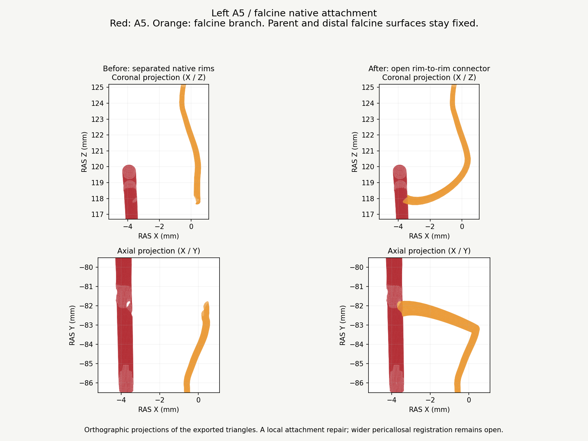

# Batch 5: left falcine native attachment, v0.9.87

This is a **partial correction** within the pericallosal/falcine work. G05 and G06 remain open. One physical attachment is repaired: the left ACA falcine branch to the existing left A5 opening. No other anatomical region is claimed complete.

## Delivered correction

The source branch was separated from its declared parent by a sampled minimum wall gap of 3.574 mm. Its proximal collar is now reconstructed between the existing A5 rim and a cut through the retained falcine shaft at Z = 120.5 mm. A cubic Hermite centreline and rotating cross-sections produce a rounded transition. The first straight connector was rejected at visual review because of its sharp transition; it is not the delivered geometry.

The A5 artery stays exact. All 3,964 original falcine vertices and 7,766 triangles distal to the cut are retained exactly in the actual application loader, including the existing distal anastomotic interface. The repaired label has 4,914 vertices and 9,592 triangles. Positions use lossless Float32 meshopt encoding; no extra positional quantisation is applied. All other 598 meshes in the arterial asset and the other four model files remain exact.

The joined parent port has 101 exact unique coordinates and 101 paired, oppositely oriented boundary edges. No open edge remains at this specific interface. The combined parent/branch test has zero non-adjacent triangle intersections. No new brain, bone or unrelated vessel contact is introduced. Existing falx contact counts decrease from 550 to 532; the distal anastomosis contact count stays 918. These facet counts are geometric diagnostics, not counts of distinct anatomical defects or physiological measurements.

## Excluded work and remaining problems

- Bilateral A2-A5/callosal registration and the recorded cortical contacts remain unresolved (G05). Their model buffers are unchanged. The historical rejected global displacement is not rerun.
- Right ACA native attachment trials create folds or new cingulate/precuneal contacts. Both MMA terminal attachments remain open: small rim adjustments fold source triangles, while trimmed collar trials increase superior sagittal sinus contacts. Those models are not installed. Coupled parent/tissue/sinus reconstruction is still needed.
- The exact A5 origin remains an illustrative assignment. An original dissection supports a pericallosal dural branch, rather than a universal A5 origin: [Bhogal et al., 2015](https://pmc.ncbi.nlm.nih.gov/articles/PMC4757356/).
- Whole falcine lumen continuity, precise dural containment, all earlier G01/G03/G04/G07/G08 findings and the 12 deferred arterial segments remain open.

## Integration and verification

Current bounds, hashes, the branch description and its cisternal-to-dural course classification are updated. Its DSA projection recipe and injection course are regenerated. All other 596 arterial course entries and the declared flow graph are retained after verifying their unchanged geometry. Individual closed DSA proxies do not establish whole-network native lumen closure.

Validation uses the actual GLTFLoader, exact retained-buffer comparisons, local and combined native-wall checks, one targeted before/after visual check, catalogue/course checks, a production build and the complete numerical DSA suite. There is no repeated full browser render for this geometry-only change.

See [measurements and rejected candidates](validation/native-attachments-v0.9.87.json) and [release checks](validation/batch5-release-v0.9.87.json). Optional authoring tools are in `tools/native-attachments-v0.9.87`; the app has no new dependencies.
