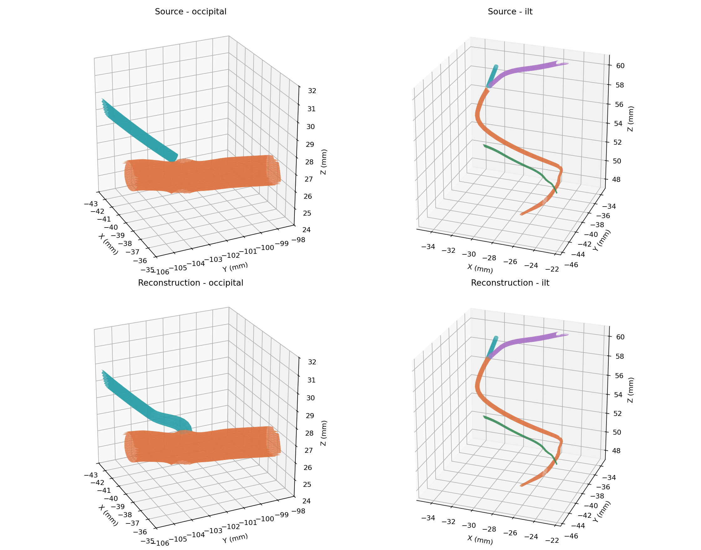

# Native attachment batch 3, v0.9.95

Three recorded native-interface failures are repaired, reducing the current cohort from four to one. This release changes the left occipital parent and mastoid branch and the left ILT posterior branch. All 1,250 named meshes, 1,666 catalogue structures, relationships and 21 runtime source files are retained.

| Interface | Delivered result |
| --- | --- |
| Occipital mastoid to occipital, left | 108 exact shared coordinates and opposite paired native edges |
| ILT posterior to anterior branch, left | 64 exact shared coordinates, 63 paired boundary edges |
| ILT posterior to trunk, left | 69 exact shared coordinates, 68 paired boundary edges |
| ILT posterior to posteromedial ramus, left | Unresolved; wider course/bone registration required |

The occipital mastoid source cap is reopened and a short native collar fitted to the existing parent opening. An exterior union removes three local parent overlaps. No synthetic internal cap walls remain. All other original branch attachment coordinates stay fixed. The compound ILT root is aligned with a 1 mm harmonic support; maximum displacement is 0.5260267 mm. The two component interfaces meet at two common coordinates. The other ILT rims stay fixed.

All changed faces pass whole-scene triangle checks, including adjacent and coplanar overlap: 72,643 candidate triangle pairs, zero crossings. Sampled closed tissue volumes and conservative open-target surface-clearance bounds pass. The combined occipital boundary-edge count reduces from 872 to 766, and the four-label ILT network from 800 to 538. No new non-manifold or misoriented edges are introduced. Two existing remote ILT network edge defects remain.

The final GLTFLoader export matches all staged positions, indices and normal integers. Every retained source triangle keeps its exact corner normals. All 596 other arterial meshes and the four other assets remain byte-exact in decoded geometry or asset bytes respectively. Three DSA proxies and courses are refreshed; all 594 other courses, the graph, vein sites and generator are retained. Production build, DSA checks and 19 repair tests pass.

The last posteromedial outlet cannot be accepted by moving its rim. Wide snap trials overturn more than 1,500 faces. An initial replacement loft also fails crossings and native orientation. A corrected sidearm orientation resolves the candidate's own edge topology, but its fixed distal port is entirely inside the current sphenoid: all 141 coordinates, signed depth about 0.77-1.38 mm. A connector to that fixed port enters bone. The candidate is excluded; a solid bone mesh does not establish a usable anatomical canal. Wider vessel/bone registration and independently supported canal geometry are required.

These results establish local numerical repairs only. Wider anatomical acceptance of all 12 deferred segments, exact dural/bone containment, full receiving lumens, right ACA/pericallosal registration and earlier open issues remain unresolved. Existing remote defects are retained. Source buffers, construction inputs, rejected trials and detailed gates are in `anatomy/source/native-batch3-v0.9.95`. Authoring replay is documented in `tools/native-batch3-v0.9.95/README.md`.

