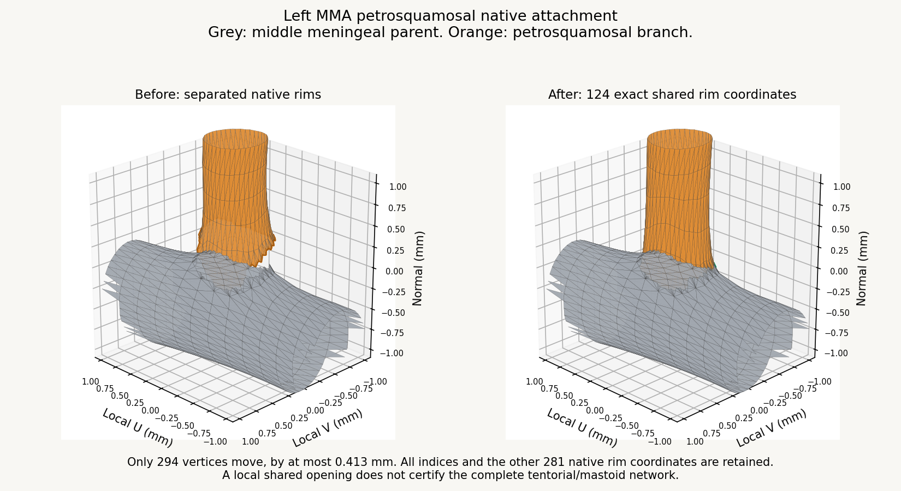

# Native attachment continuation, v0.9.90

The left MMA petrosquamosal parent opening is repaired. This clears one recorded missing native interface in the deferred cohort, reducing its failed interface records from 10 to 9. All 12 segments remain under wider anatomical review. Right ACA feasibility work identifies a source port/cortex conflict; none of those outlet candidates is installed.

## Delivered correction

The petrosquamosal and middle meningeal parent rims each have 124 native coordinates. Their original centres were separated by 0.2481 mm. A bounded displacement and harmonic shape adjustment aligns the branch rim exactly to the unchanged parent. The deformation fades within a 1 mm surface-distance support, with its other three native rims fixed.

Only 294 of 27,933 branch vertices move, by at most 0.4125 mm. The other 27,639 coordinates and every triangle index remain exact. All 55,465 native triangles retain their original ordering. The other three attachment rims contain 281 coordinates in total, all retained exactly.

The joined opening has 124 exact shared coordinates and 124 paired, oppositely oriented boundary edges. The actual application loader confirms identical encoded normals at this seam, and exact retained positions and normals at the other three rims. No wall is added across the opening. The parent artery is unchanged.

All potentially changed intersection pairs are checked: each of the 505 affected triangles is tested against the entire branch and parent, before and after the correction. There are no new self-intersections, parent intersections or reversed faces. The affected region introduces no new or increased brain, bone or unrelated-vessel contact. Remote triangles remain exact and their existing wider review findings are retained. This local repair does not certify the whole tentorial/mastoid route or its receiving lumens.

## Right ACA outcome

The existing right A5 attachment port lies approximately 0.487 to 0.664 mm inside the registered posterior dorsal cingulate surface according to the signed-distance diagnostic. That cortical mesh has no native boundary loop. The ordinary falcine connector crosses it, producing the previously observed 104 facet contacts. These are measurements of the represented meshes, not independent clinical anatomy.

The neighbouring A5 outlet is only 0.529 mm away along the native surface. Twelve local shortening trials with other outlets fixed either retain inadequate cortical clearance or fail the deformation quality gates. None is installed. The right ACA, A5, neighbouring branches and brain remain exact. Wider pericallosal/cortical registration must be addressed before repeating connector fitting. See [feasibility measurements](validation/right-aca-feasibility-v0.9.90.json).

## Integration and validation

All other 598 arterial meshes retain exact decoded position, index and normal buffers. The other four model files remain byte exact. All 1,250 named meshes remain in the 1,666-entry catalogue. Every earlier ACA and MMA repair is retained. The 21 application runtime source files are byte exact against v0.9.89.

Bounds, hashes, local attachment metadata and the issue ledger are updated. One closed DSA recipe retains its native indices, caps and orientation; only the affected cap centre and volume are refreshed. One injection course is regenerated and remains selectable. The other 596 arterial course entries, existing falcine guides, anatomical graph and vein sites are unchanged. The affected incoming attachment distance is refreshed.

The production build, full numerical DSA suite and 14 course tests pass. DSA retains 828 closed and oriented meshes containing 8,961,216 triangles, 578 selectable arterial courses and 2,350 closed sections. Directed injection and meningeal drainage checks pass. The existing bundle-size warning remains. One targeted local visual review is used alongside loader and numerical checks; full browser playback is not repeated.

## Remaining work

- Right ACA attachment and wider pericallosal/callosal registration (G05/G06).
- Nine recorded native-interface failures in the deferred 12-segment cohort.
- Independent compartment support, exact bone/dural fit and whole receiving-lumen continuity.
- Earlier Galenic, cortical, petrosal and other recorded G01/G03/G04/G07/G08 findings.

Whole anatomical acceptance remains false. See [correction measurements](validation/petrosquamosal-v0.9.90.json) and [release checks](validation/native-attachment-release-v0.9.90.json). Optional tools are under `tools/native-attachment-v0.9.90`; baseline and final buffers are under `anatomy/source/native-attachment-v0.9.90`. The app has no new dependency.
