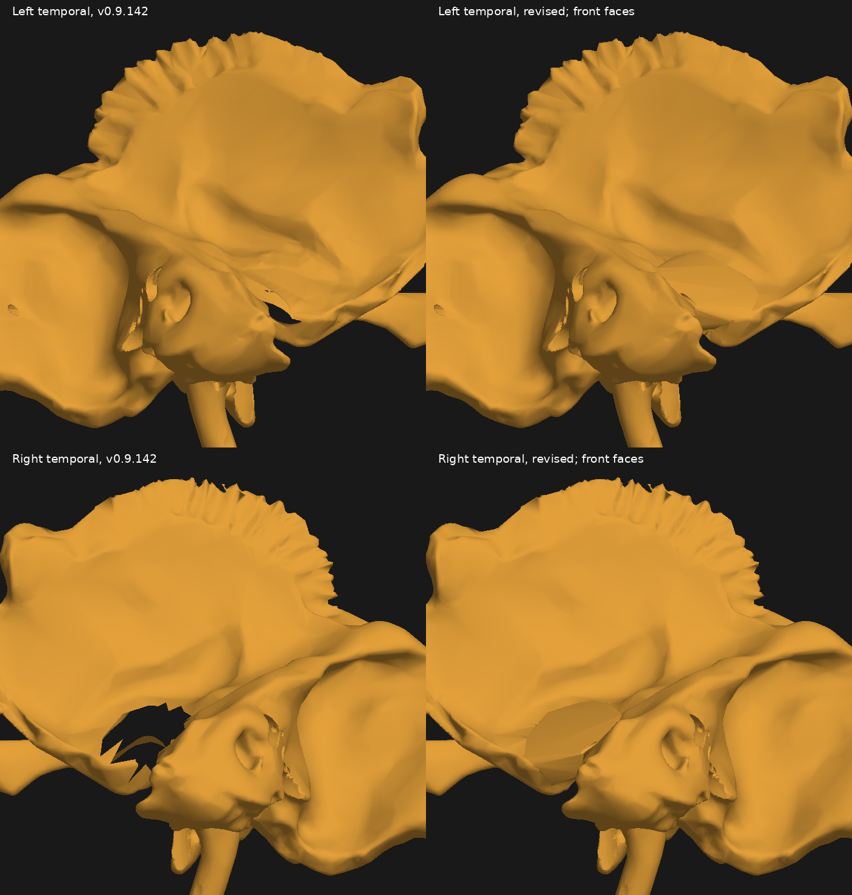
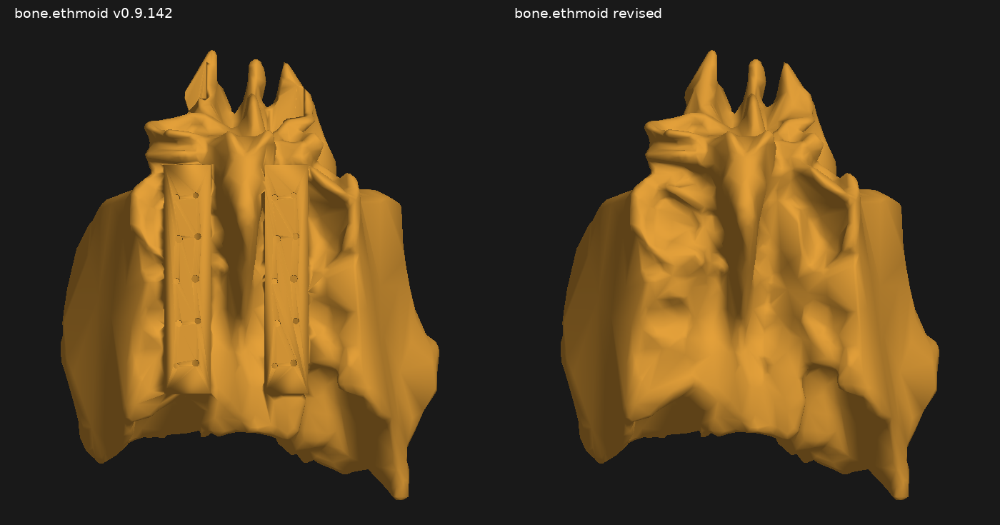

# Foramina and bilateral temporal revision, v0.9.143

This release responds to the unrealistic ethmoid additions, oversized drilled openings and persistent temporal defects. Both temporal bones are repaired independently. The larger jagged opening was on the right; the left also retained a smaller residual gap in v0.9.142.

## Changes and measured sizes

| Region | v0.9.143 result | Basis |
| --- | --- | --- |
| Ethmoid | Original source bone restored, including original normals. Ethmoidal arteries retained. | Exact decoded mesh comparison. Artificial perforated shelves and recesses removed. |
| Both temporal defects | Connected local bone volumes replace the jagged gaps; concave joint surfaces retained. | Three front-face views per side, saved GLB intersection checks and neighbouring vessel checks. |
| Optic canals | Approximately 3.30 x 4.20 mm at the middle section. | Enclosed oval section, 72/72 ray coverage on both sides. Previous minor dimension was about 4.89 mm. Large rounded projecting roofs removed. |
| Hypoglossal canals | Approximately 3.20 x 3.90 mm at the middle section. | Enclosed oval section, 72/72 ray coverage on both sides. Native flared mouths retained. Previous middle minor dimension about 3.8 mm. |
| Facial canals | Graduated local calibre; approximately 1.46 mm at the middle sample. | Smooth-axis samples approximately 1.35, 1.46 and 1.56 mm at 30%, 50% and 70%. Previous authored bore was a uniform 2.3 mm. |
| Incisive canal | Approximately 3.00 x 3.80 mm at the common middle section. | 72/72 ray coverage with both separate alveolar meshes included. Artificial 6 mm enlargement removed; paired superior branches retained. |
| Foramina spinosum | Approximately 2.40 mm at the middle section, retained. | Within reported adult variation. The attempted smaller cut did not narrow the existing pre-cut source lumen, so no narrowing is claimed. |

Dimensions describe the stated sample plane, not every flare or mouth. The [full family inventory](foramina-revision143-aperture-audit.csv) separates actual measurements from prior authoring parameters, open grooves, native fissures and unresolved variants. The [radial section data](foramina-revision143-aperture-sections.json) retain sampling points, planes and missing-ray information.

The other added passages were reviewed for gross enlargement, their source morphology and nominal parameters. Small facial, palatal and skull-base passages were retained where no clear oversizing was demonstrated. Naturally large or irregular structures, such as the jugular foramen and orbital fissures, were not reduced using a universal circular diameter. Native ovale/rotundum shapes and jugular asymmetry were preserved. This is a reference-guided audit, not a claim that every source opening has a certified clinical diameter.

## Temporal repair

The previous left repair did not address the much larger right defect and could leave a visible gap when rendering only front-facing triangles. Each side now joins both source margins as a connected bone volume. The repair retains the original small ear-opening boundary rather than sealing the external acoustic region.

The joint surface is shaped around a 0.15 mm expanded envelope of the registered mandibular condyle. This clears the new repair from the condylar mesh; it is a geometric clearance allowance, not an anatomical joint-space measurement. A narrow petrotympanic slit and the small tympanic arterial passages are retained. Native sphenoid/temporal interface contacts remain from the source and are documented separately from the repaired hole.



## Vessels and unresolved source features

The ophthalmic arteries, ethmoidal arteries, PICA anatomy, all venous meshes and brain-context asset are preserved. Ten local arterial surfaces near the hypoglossal and incisive passages are fitted with the same smooth regional fields as their connected interfaces. Their source courses, guide data and DSA surfaces are updated together. The DSA refresh retained the other 597 flow entries exactly.



The restored ethmoid does not resolve individual olfactory microforamina. Cribriform landmarks now state this limitation instead of presenting an invented regular perforation pattern. Wider legacy vessel/bone contacts remain in the residual issue register. The regional audit found no new contact pairs against the v0.9.142 baseline, but this does not resolve or certify those existing findings. Native segmentation gaps remain elsewhere in maxillary/alveolar source surfaces.

## Verification

- Production build and seven regional DSA/landmark suites passed, together with posterior, petrous and small-passage geometry checks.
- The final saved temporal surfaces have consistent winding, no non-manifold edges and no material self-crossings or crossings at the source joins under the independent 0.002 mm FCL/SAT screen.
- Both temporal repairs clear the nearby arterial and venous surfaces. Three front-face views per side show zero remaining dark pixels in the projected original defect region.
- Unedited meshes were compared as decoded position, triangle and normal arrays. The venous and brain-context assets remain byte-identical.
- Current numerical evidence is in [the validation report](foramina-revision143-validation.json), [saved geometry checks](foramina-revision143-saved-geometry.json) and [command results](foramina-revision143-check-suite.json). Historical batch reports describe their earlier releases and do not override these current results.

## Primary anatomical references

Reference measurements vary with population, plane, mouth versus throat and imaging method. They guided conservative proportions rather than a universal fixed size.

- Optic canal CT morphometry, 335 subjects: https://pubmed.ncbi.nlm.nih.gov/31245611/ and https://bmjophth.bmj.com/content/4/1/e000302
- Hypoglossal canal morphometry and shape: https://pubmed.ncbi.nlm.nih.gov/36930271/ and https://pubmed.ncbi.nlm.nih.gov/37941031/
- Ovale, rotundum and spinosum CT morphometry: https://pubmed.ncbi.nlm.nih.gov/37228912/
- Facial canal CT and anatomical variation: https://pubmed.ncbi.nlm.nih.gov/22842789/ and https://pubmed.ncbi.nlm.nih.gov/2952135/
- Incisive canal dimensions: https://pubmed.ncbi.nlm.nih.gov/34522664/ and https://pubmed.ncbi.nlm.nih.gov/37975024/
- Infraorbital foramen morphometry: https://pubmed.ncbi.nlm.nih.gov/29072226/
- Sphenopalatine foramen morphometry: https://pubmed.ncbi.nlm.nih.gov/32821444/

## Installation and online update

Keep the ZIP intact beside your existing installer. To run locally:

```bash
./inr-anatomy.sh local ./inr-anatomy-atlas-v0.9.143.zip
```

To update your configured GitHub Pages deployment:

```bash
./inr-anatomy.sh update ./inr-anatomy-atlas-v0.9.143.zip
```

For an extracted Docker installation, run `./docker.sh restart` within the release directory. For a source build, use Node 22 or later, `npm ci` and `npm run build`. This package does not itself publish or change the live website.
