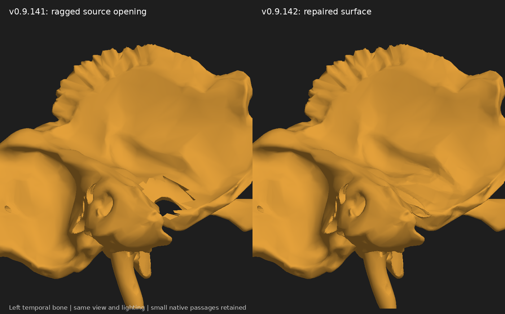

# Left temporal surface reconstruction, v0.9.142

The large angular opening visible in v0.9.130 persisted in v0.9.141. Its star-shaped margin came from two ragged open boundaries in the source temporal mesh, rather than a cleanly modelled anatomical aperture. This release adds a refined surface across that defect at the squamous/tympanic junction.

The reconstruction keeps every original source vertex position. It triangulates only the selected boundary regions, refines the local triangles, and fairs the new interior with the rim held fixed. Native coincident source vertices remain separate. A narrow tympanic fissure and the existing ear-region opening are retained. The new surface is trimmed around the anterior and inferior tympanic arteries, without moving or reshaping any vessel.

The acoustic, facial, carotid and other skull-base routes are checked through the existing regional regression suites. New surface triangles are checked against one another, the retained bone surface, and every overlapping arterial or venous mesh. Numerical plane-crossing bounds above 0.002 mm are treated as material surface intersections. This is a collision-screen threshold, not a statement of anatomical accuracy.

The comparison image uses identical orthographic views and lighting of the decoded release assets. Orange represents the isolated left temporal bone; dark regions are background.

This is a local teaching reconstruction of legacy context geometry. It does not establish patient-specific plate thickness or remove unrelated source-mesh defects. The whole-model findings in `skull-foramina-residual-issues.md` remain open. The temporal bone retains small native open boundaries and is not claimed to be globally watertight.

Method parameters: `anatomy/source/foramina/temporal-surface-repair.json`. Results: `temporal-surface-repair-validation.json` and `temporal-surface-repair-check-suite.json`.

## Anatomical context

Rodríguez-Vázquez et al., 2011, *Closure of the middle ear with special reference to the development of the tegmen tympani of the temporal bone*: https://pubmed.ncbi.nlm.nih.gov/21477146/. The tegmen separates the middle ear from the cranial cavity; the small regional fissures should not be replaced with a broad jagged defect.

Normal CT appearances of the external acoustic canal and its fissures: https://pubmed.ncbi.nlm.nih.gov/6841714/.
